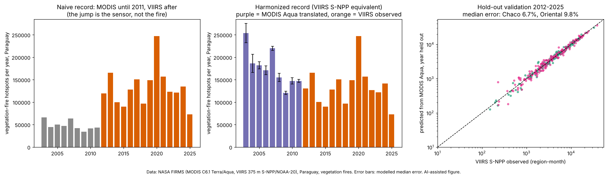

# Tata Rekavo — harmonized MODIS + VIIRS fire record for Paraguay

**NASA Space Apps Challenge 2026 · Asunción · Challenge: _Harmonization of MODIS and VIIRS Hot Spots_**

**Live app: https://tata-rekavo.vercel.app** (English / Español)

Available countries: Paraguay, Bolivia, Uruguay, Peru and mainland Ecuador. Each country has its own calibration and validation; see the country sections below for limitations.

*Tata Rekavo* means "fire tracker" in Guaraní.

Satellites have counted fire hotspots over Paraguay since 2000, but the record is split in two: MODIS (Terra, Aqua) since 2000 and VIIRS (Suomi NPP, NOAA-20) since 2012. VIIRS has a finer pixel (375 m vs 1 km) and detects about **3.4 times more hotspots** over Paraguay. Stitching the raw records together makes burning appear to jump **×2.8 after 2012**, and that jump comes from the change of sensor, not from more fire. This repository turns both records into **one consistent monthly series in a single unit: VIIRS S-NPP-equivalent hotspots**, validated against real VIIRS observations, with a measured error for every value.



## Method

1. **Data.** NASA FIRMS yearly country archives for Paraguay, standard processing: MODIS Collection 6.1 (Terra, Aqua) and VIIRS 375 m (S-NPP, NOAA-20). Vegetation fires only (`type = 0`). 3,982,768 hotspots, Nov 2000 – Dec 2025.
2. **Common unit.** We translate MODIS **toward** VIIRS, not the other way around. VIIRS is the operational sensor and the finer one, so current months are read as observed.
3. **Calibration.** For each region (Chaco / Oriental) and calendar month:
   `f(region, month) = VIIRS S-NPP hotspots ÷ MODIS Aqua hotspots`, over the overlap Feb 2012 – Dec 2025.
   - **Aqua, not Terra + Aqua.** Aqua crosses at ~13:30 like S-NPP. The Terra/Aqua mix changes over time (Aqua/Terra fell from 2.5 in 2003 to ~1.5 after 2011). Aqua-based factors extrapolate back in time with near-zero bias.
   - **Region × month.** The factor ranges from ~4.4 in the dry-season peak (large fires seen by both sensors) to ~9 in the wet season (small fires that only VIIRS resolves). A single factor leaves +12 % / −14 % regional biases.
4. **Reconstruction.** Before Feb 2012: Aqua hotspots × f. From Feb 2012: VIIRS S-NPP observed. The record starts in **Jul 2002**, the first full month with Aqua.
5. **Sensor outages.** Days where one sensor delivered nothing while its twin saw fire are excluded from calibration and filled with the twin sensor:
   - S-NPP gaps are filled with NOAA-20 (S-NPP/NOAA-20 monthly ratio: median 1.02).
   - Aqua gaps are filled with Terra × its own factor.

   41 S-NPP outage days and 50 Aqua outage days were detected, e.g. 27 Jul – 5 Aug 2022, in the middle of the fire season. Every filled day is listed in `gaps.json`.
6. **Uncertainty.** For translated months, the median relative error depends on how many hotspots a zone has. It was fitted on held-out data across all aggregation levels:
   `rel(n) = 1.252 · n^-0.334` (n = harmonized hotspots in the zone-month).
   A systematic term (0–11 % by year, from comparing Aqua-based and Terra+Aqua-based reconstructions) is added in quadrature. Observed VIIRS months carry no translation error.
7. **Verdict.** Value ÷ median of the same calendar month in previous years:
   - below normal < 0.5
   - normal 0.5–1.5
   - high 1.5–3
   - extreme > 3

   For a month still in progress, the median is scaled to the elapsed share of the month.

## Validation

**Leave-one-year-out.** Calibrate on 13 years, predict the held-out year from MODIS Aqua, and compare with VIIRS S-NPP:

| Level | Median error | 90th pct error | Bias |
|---|---|---|---|
| Paraguay × month | 7.0 % | 19.1 % | 0.0 % |
| Chaco × month | 6.7 % | 21.4 % | 0.0 % |
| Oriental × month | 9.8 % | 28.7 % | 0.0 % |
| 1° block (~110 km) × month | 19.6 % | 52.9 % | 0.0 % |
| 0.5° cell (~55 km) × month | 25.6 % | 69.6 % | 0.0 % |
| 0.25° cell (~28 km) × month | 32.8 % | 84.1 % | 0.0 % |
| 0.1° cell (~11 km) × month | 46.7 % | 100 % | 0.0 % |

**Back-extrapolation.** Calibrate on 2019–2025 and predict 2012–2018. Yearly bias: +1.2, 0.0, −0.3, −3.2, +5.9, +0.2, +2.4 %.

**Does the verdict class match the one VIIRS would give?** Paraguay 95 %, Chaco 91 %, Oriental 86 %, 1° blocks 76 % of months.

**Effect.** Mean 2013–2025 vs mean 2003–2011: naive record ×2.78, harmonized ×0.76. MODIS alone, with no sensor change, gives ×0.82.

**Harmonized FRP (experimental).** The same method also runs on Fire Radiative Power: the factor is the summed S-NPP FRP over the summed MODIS Aqua FRP, per region and calendar month, on the same clean overlap days, and the result is total FRP per cell-month in MW, VIIRS S-NPP-equivalent (`frp.json`, built with `build-frp`). Aqua factors range from 1.03 to 2.77, and they barely move when a year is left out (median per-fold spread 1.4 %, counts 0.9 %). Leave-one-year-out median error, with 90th percentile and bias: Paraguay 8.5 % (22.7 %, +1.1 %), Chaco 10.4 % (32.8 %, +0.4 %), Oriental 14.3 % (39.6 %, +2.2 %). The count record gets 7.0 %, 6.7 % and 9.8 %. FRP errors are larger, and the 90th percentile shows more of that, because a few large fires carry much of a month's FRP. The file is flagged `experimental` if the country median error goes above 25 %, which it does not today.

The approach follows the same principle used in the literature to bridge the MODIS → VIIRS transition: regional statistical calibration over the overlap period.
- NASA VIIRS burned area product (VNP64A1), *Remote Sensing of Environment* — anticipates the need for regional-scale statistical calibration between VIIRS and MODIS to provide a single long-term record: https://geog.umd.edu/sites/geog.umd.edu/files/pubs/1-s2.0-S0034425725004109-main.pdf
- GFED5NRT (Chen et al., 2026, *Earth System Science Data*) — region- and biome-specific lookup tables to keep VIIRS consistent with the MODIS-era record: https://essd.copernicus.org/articles/18/7535/2026/
- Boschetti, *Harmonization of the NASA MODIS and VIIRS fire product record*, MODIS Science Team Meeting 2023: https://modis.gsfc.nasa.gov/sci_team/meetings/202305/presentations/boschetti.pdf

## Data products (`data/app/`)

| File | Content |
|---|---|
| `grid.json` | Harmonized record on a 0.1° grid, monthly, Jul 2002 – Dec 2025 (3,632 cells, 305k cell-months, ~1 MB gzipped). Includes factors, error model and validation in `meta` |
| `current.json` | 2026 months from the FIRMS Area API, clipped to Paraguay. For each day it uses the best VIIRS product available: S-NPP first, NOAA-20 / NOAA-21 when S-NPP has no data, standard processing before near-real-time. Includes per-month coverage and the products used. Cell entry: `[cell_index, month_indices[], viirs_hotspots[], viirs_frp_mw[]]` (4th array optional: observed FRP sum, no factor) |
| `current_hotspots.csv` | The 2026 hotspots themselves |
| `burn_history.json` | ~1 km rasters: last year each cell burned, and number of years it burned (2002–2025) |
| `series_regions.csv` | Monthly harmonized / raw MODIS / raw VIIRS for Paraguay, Chaco, Oriental |
| `grid_monthly.csv` | Same as `grid.json` in long CSV form |
| `hotspots/*.csv.gz` | Individual hotspots Jul 2002 – Dec 2025, one gzip CSV per 1° block (~46 MB in total), with `harmonized_weight`, plus `index.json` |
| `departments.json` | The 17 departments (Asunción merged into Central): simplified boundary, bounding box and the grid cells whose centre falls inside, so every cell belongs to exactly one department. Boundaries from geoBoundaries (see below) |
| `gaps.json` | Detected sensor outages and the days filled |
| `mask.json` | ~5 km country mask (cells with any hotspot in the Paraguay archives), used to clip API data |
| `frp.json` | Experimental: harmonized Fire Radiative Power (MW per cell-month, VIIRS S-NPP-equivalent) on the `grid.json` cell and month index, with FRP factors, its own leave-one-year-out validation, error model and the `experimental` flag in `meta`. Cell entry: `[cell_index, month_indices[], frp_mw[]]` |
| `context.json` | Fire statistics per protected area (WDPA / WD-OECM), built by `build-context`: sparse monthly series of hotspots (`n`) and Fire Radiative Power (`frp`, MW) for each area and for the union of the areas per zone (Paraguay, Chaco, Oriental, each department). Each area also has `by_zone`: its own series restricted to each department or region it overlaps. Statistics only: it carries no geometry (a test checks it), so the WDPA data is shown but not redistributed. `meta.through` / `meta.through_day` are the last month and day it covers, `meta.retrieved` the WDPA download date |
| `metrics.json` | Full validation results |
| `validation.png` | Naive vs harmonized record + hold-out validation |

`grid.json` cell entry: `[cell_index, month_indices[], harmonized[], modis_raw_terra_aqua[], viirs_snpp_raw[]]`, with
`cell_index = row * 88 + col`, `row = floor((lat + 28) / 0.1)`, `col = floor((lon + 63) / 0.1)`, `m = (year − 2002)·12 + (month − 7)`.

`harmonized.js` implements everything the web app needs, with no dependencies:
- `decodeGrid`, `cellsInPolygon`, `zoneSeries`
- `verdict`, `monthCoverage`, `calendar`, `relativeError`
- `protectedSummary` (fire inside protected areas from `context.json`)
- `decodeBurnHistory`, `seriesToCSV`

`test_contract.mjs` checks it against the pipeline output.

## Web app (`app/`)

**Is this fire normal?** Pick an area, a month and a date range:

- **Area:** Paraguay, the Chaco, the Oriental region, any of the 17 departments (from the ranking below), any polygon drawn on the map, or a point (latitude / longitude) with a radius.
- **Verdict:** the selected month against the median of the same month in previous years, with its error band. A month still in progress is compared with the same share of a typical month.
- **Where is fire abnormal?** Every department ranked for the selected month by its ratio to its own usual level, with the error band, the verdict class and the hotspot count. Click one to make it the area: the map frames it and the verdict, calendar and charts follow. A month in progress uses the same partial-month scaling as the verdict. Departments whose usual count for that month is under 10 hotspots (or with no history) are not given a ratio; they are listed last as "low signal". On phones the list is folded. A department link keeps the selection (`z=department&dep=<id>`). If `departments.json` cannot be loaded the panel is hidden and the rest of the app is unaffected.
- **Protected areas:** under the verdict, when at least 1 hotspot (or 1 MW) of the month falls inside protected areas, a line says how many and what share of the month, and names up to three areas (with their class when high or extreme). A folded "Protected areas" block lists every area that overlaps the selected zone with its value, ratio to its own usual level and class. Areas overlap, so the rows can add up to more than the total, which counts each hotspot once. In a department or region each row counts only the fire of the area inside that zone (`by_zone`). It works for Paraguay, the regions and the departments, not for a custom area, and only up to the day `context.json` covers: it needs the private WDPA geometry, so the daily workflow cannot rebuild it. Later months, and the last month when newer hotspots exist, say so instead of showing old figures. Only statistics are shown, never WDPA geometry. If `context.json` cannot be loaded the block is hidden. Next step: the same for indigenous territories.
- **Date range analytics:** total hotspots (± error), ratio to the usual for those months, peak month, months above or below normal, and hotspots in new places. Presets: this year, last 12 months, fire season (Jul–Oct), all.
- **Burning calendar:** years × months, in two modes.
  - *vs normal* (diverging, ratio to the usual level).
  - *Hotspots* (sequential counts, with a "typical year" row that shows when the fire season happens).

  Months reconstructed from MODIS are hatched. The tooltip includes a field-validation hint ("Modo Catador") that turns the model uncertainty into guidance for checking imagery.
- **Hotspots per year:** a toggle between the harmonized record and the raw sensors stitched together, which shows the false 2012 jump.
- **Map:** hotspots per ~11 km cell for the month, plus the individual VIIRS hotspots for 2026.
- **Fire in new places:** 2026 hotspots with no hotspot from any sensor within ~1 km (same or neighbouring 0.01° cell) from July 2002 to December 2025. That is about 2% of them. They are highlighted on the map and flagged in the CSV (`new_place`). Comparing exact cells instead would flag ~10%, which mostly reflects pixel geolocation offsets, so the neighbourhood is required. Hotspots right at the border may be over-flagged, because the history only covers Paraguay.
- **Downloads for the area and date range:**
  - The monthly harmonized series (CSV).
  - Every individual hotspot (CSV: 2002–2025 from the archives plus 2026 from the API, with `harmonized_weight` and `new_place`). The app fetches only the 1° blocks the search touches (`data/app/hotspots/`).
  - A PNG report with the calendar, the yearly chart and the analytics.
- **English / Spanish** interface (EN/ES toggle; it follows the browser language by default).

Stack: React + TypeScript + Vite + MapLibre GL. It is a static site with no backend. It reads `data/app/` and uses the same `harmonized.js` the pipeline tests run against.

```bash
cd app
npm install
npm run dev      # http://localhost:5173
npm run build    # static site in app/dist (deploy app/ on Vercel or any static host)
```

## Run it

```bash
pip install -r requirements.txt
python firms_pipeline.py download                    # ~300 MB of FIRMS archives into data/raw (resumable)
python firms_pipeline.py build                       # data/app/*.json, *.csv
python firms_pipeline.py validate                    # metrics.json, validation.png, error model into grid.json
python firms_pipeline.py build-frp                   # frp.json: harmonized FRP + its own validation (experimental)
python firms_pipeline.py export-hotspots             # data/app/hotspots: individual hotspots in 1-degree gzip blocks
FIRMS_MAP_KEY=... python firms_pipeline.py fetch-current --start 2026-01-01   # free key: https://firms.modaps.eosdis.nasa.gov/api/map_key/
node test_contract.mjs data/app
```

Never commit the MAP_KEY. Pass it through the environment only.

## Bolivia (pilot)

The pipeline is country-configurable (`countries.json`); Bolivia is the first country after Paraguay, built into `data/app/BOL/` (Paraguay stays in `data/app/` to preserve existing links). 0.25° grid (54 × 50, 1,577 cells with hotspots), 9 departments, 5 RESOLVE biomes as factor regions instead of a river split, FIRMS archives 2000–2025 (8.6 million hotspots scanned) plus the 2026 Area API data. No burn history and no per-hotspot export for Bolivia.

```bash
python firms_pipeline.py download --country BOL --data data/raw/BOL
python firms_pipeline.py build --country BOL --data data/raw/BOL --out data/app/BOL
python firms_pipeline.py validate --country BOL --data data/raw/BOL --out data/app/BOL
python firms_pipeline.py build-regions --country BOL --out data/app/BOL
python firms_pipeline.py build-season --country BOL --data data/raw/BOL --out data/app/BOL
python firms_pipeline.py build-frp --country BOL --data data/raw/BOL --out data/app/BOL
FIRMS_MAP_KEY=... python firms_pipeline.py fetch-current --country BOL --out data/app/BOL
node test_contract.mjs data/app/BOL
```

**Validation (leave-one-year-out, same method as Paraguay).**

| Level | Median error | 90th pct error | Bias |
|---|---|---|---|
| Bolivia × month | 7.4 % | 21.5 % | -1.0 % |
| Moist broadleaf forests × month | 12.2 % | 36.8 % | -0.5 % |
| Dry broadleaf forests × month | 11.5 % | 34.1 % | -1.7 % |
| Grasslands, savannas, shrublands × month | 9.6 % | 28.0 % | -0.2 % |
| Flooded grasslands and savannas × month | 23.2 % | 94.6 % | -1.1 % |
| Montane grasslands and shrublands × month | 29.2 % | 100 % | -6.2 % |
| 1° block × month | 22.4 % | 62.6 % | -1.0 % |
| 0.25° cell × month | 34.6 % | 100 % | -1.0 % |

The country median error (7.4 %) is under the 15 % gate. The verdict class matches the one VIIRS would give in 89.8 % of months (country), 76 % for 1° blocks. FRP (`frp.json`, not flagged experimental): Bolivia 9.1 %; by biome 12.1 % to 15.1 %, flooded grasslands 25.6 %, montane 46.3 %. Mean 2013–2025 vs 2003–2011: naive record ×3.39, harmonized ×0.80.

**Bolivia limitations.**

- **Two small biomes are noisy.** Flooded grasslands (23.2 %) and montane grasslands (29.2 %, FRP 46.3 %) are above 15 %. They have few clean overlap hotspots per month, so many calendar months fall back to the country factor (grid.json `factor_fallback`, Aqua / Terra: flooded grasslands 6 / 5 months, montane 8 / 12, moist forests 3 / 5). Read the error band, not the point value, for these zones.
- **Back-extrapolation is biased.** Calibrating on 2019–2025 and predicting 2012–2018 overestimates VIIRS S-NPP by +9.6, +10.8, +21.7, +14.7, +9.7, +15.3 and +15.2 % per year (Paraguay: within about 6 %). The error model adds a systematic term for 2002–2012 (2 to 16 %) so the app's error bands for the MODIS-only years are wider than the random error alone.
- **Cell level is coarse.** A 0.25° cell has 34.6 % median error and a 0.1° cell 47.0 %; the pilot uses a 0.25° grid for that reason.
- **Biomes are an approximation.** Factor regions are RESOLVE biomes of the hotspot's 0.05° cell, not a fire-behaviour classification.

## More countries (Uruguay, Peru, Ecuador)

Same pipeline and commands as Bolivia (`--country URY|PER|ECU --data data/raw/<ISO3> --out data/app/<ISO3>`), each with its own grid, department ranking (geoBoundaries ADM1) and factor regions from `countries.json`. No burn history and no per-hotspot export. Cross-border areas (Pantanal, Chaco, Amazon) are cut at the national border: a country's area covers only its own side.

### Ecuador

0.1° grid over the mainland (66 × 60, 1,595 cells with hotspots; Galápagos is outside the grid and its province is left out of the ranking, so 23 provinces), 4 RESOLVE biomes as factor regions, FIRMS archives 2000–2025 (525,003 hotspots scanned) plus the 2026 Area API data. Only vegetation hotspots inside the published mainland grid enter calibration, outage detection, validation and the reconstructed record: Galápagos is excluded consistently, including from the country fallback factors. Of the six biomes in the bounding box, flooded grasslands (22 cells) and coastal desert (1 cell) are too small to be a preset of their own (rule used for all countries: at least 500 vegetation hotspots and a region of at least 25 grid cells); their hotspots use the country factor.

| Level | Median error | 90th pct error | Bias |
|---|---|---|---|
| Ecuador × month | 23.7 % | 74.3 % | 0.8 % |
| Moist forests (Amazon, Chocó) × month | 26.6 % | 73.2 % | 0.0 % |
| Dry forests (coast) × month | 38.8 % | 238.1 % | 4.8 % |
| Highlands (Andes, páramo) × month | 73.6 % | 100 % | -35.3 % |
| Mangroves × month | 64.4 % | 149.7 % | 16.1 % |
| 1° block × month | 35.0 % | 85.5 % | 0.8 % |
| 0.1° cell × month | 58.8 % | 118.7 % | 0.8 % |

The verdict class matches the one VIIRS would give in 72.5 % of months (country), 64.1 % for 1° blocks. FRP (`frp.json`, flagged experimental because the country error is above 25 %): Ecuador 28.7 %. Mean 2013–2025 vs 2003–2011: naive record ×4.34, harmonized ×0.86.

**Ecuador limitations.**

- **The country median error (23.7 %) is above the 15 % gate.** The monthly Aqua-to-VIIRS ratio remains noisy (Spearman 0.645 between translated and observed anomalies). The values before 2012 are rough: use the error band, and treat the verdict class as indicative only. The app shows the band for every month before 2012; from 2012 on the value is observed VIIRS, with detected sensor outages filled as described in the method.
- **Every biome falls back to the country factor** in at least 7 calendar months, and highlands and mangroves in all 12 (grid.json `factor_fallback`): the regions differ from the country in their cells, not in their factors.
- **Back-extrapolation is unstable.** Calibrating on 2019–2025 and predicting 2012–2018 is off by −6.2 % to +43.9 % depending on the year.
- **Galápagos is not covered** (hotspots of the islands are not counted; no province entry).

### Peru

0.25° grid (74 × 52, 1,715 cells with hotspots), 24 departments, 4 RESOLVE biomes as factor regions, FIRMS archives 2000–2025 (2.03 million hotspots scanned) plus the 2026 Area API data. Savannas and flooded grasslands (under 500 hotspots) and mangroves (2,834 hotspots, a strip of Tumbes: 21 cells) are not factor regions; their hotspots use the country factor. Lima is the department of Lima: the Lima region, the Metropolitan Municipality of Lima (Lima Province) and El Callao (146 km², smaller than one grid cell) are merged into it, so there are 24 units, not 25.

| Level | Median error | 90th pct error | Bias |
|---|---|---|---|
| Peru × month | 11.3 % | 28.5 % | -1.0 % |
| Moist forests (Amazon, Yungas) × month | 12.7 % | 37.1 % | 0.3 % |
| Dry forests (north coast) × month | 47.0 % | 81.5 % | -33.3 % |
| Highlands (Puna) × month | 28.7 % | 100 % | -3.1 % |
| Coastal desert × month | 19.5 % | 50.2 % | -3.0 % |
| 1° block × month | 30.2 % | 74.4 % | -1.0 % |
| 0.25° cell × month | 41.8 % | 100 % | -1.0 % |

The country median error (11.3 %) is under the 15 % gate. The verdict class matches the one VIIRS would give in 82.6 % of months (country), 63.9 % for 1° blocks; by biome 80.2 % (moist forests), 56.6 % (dry forests), 68.8 % (highlands), 81.4 % (coastal desert). FRP (`frp.json`, not flagged experimental): Peru 15.6 %; moist forests 16.4 %, coastal desert 27.8 %, dry forests 50.8 %, highlands 51.6 %. Mean 2013–2025 vs 2003–2011: naive record ×4.84, harmonized ×0.98.

**Peru limitations.**

- **Three biomes are above 15 %.** Dry forests (47.0 %, bias -33 %), highlands (28.7 %) and coastal desert (19.5 %) have few fires, and the dry forests use the country factor in all 12 calendar months (grid.json `factor_fallback`), as does the coastal desert's Terra factor. Read the error band for those zones.
- **The Amazon is cut at the border.** The moist-forest area covers only Peru's side of the Amazon basin; fires in Brazil and Bolivia are not counted.
- **Cell level is coarse.** A 0.25° cell has 41.8 % median error and a 0.1° cell 54.7 %.
- **Biomes are an approximation.** Factor regions are RESOLVE biomes of the hotspot's 0.05° cell, not a fire-behaviour classification.

### Uruguay

0.1° grid (50 × 55, 1,728 cells with hotspots), 19 departments, FIRMS archives 2000–2025 (97,392 hotspots scanned) plus the 2026 Area API data. Only one of the four biomes in the bounding box has the 500 vegetation hotspots a factor region needs (tropical and subtropical grasslands, savannas and shrublands: 95,028 hotspots, the "campos"; the others have 125, 99 and 9), so the biome is the whole country: the app offers no separate preset for it and the factors are the country's.

| Level | Median error | 90th pct error | Bias |
|---|---|---|---|
| Uruguay × month | 21.1 % | 70.6 % | 0.6 % |
| 1° block × month | 24.2 % | 63.2 % | 0.6 % |
| 0.25° cell × month | 36.9 % | 100 % | 0.6 % |
| 0.1° cell × month | 58.3 % | 106.7 % | 0.6 % |

The verdict class matches the one VIIRS would give in 71.3 % of months (country), 69.1 % for 1° blocks. FRP (`frp.json`, experimental): 26.4 %. Mean 2013–2025 vs 2003–2011: naive record ×1.98, harmonized ×0.65.

**Uruguay limitations.**

- **The country median error (21.1 %) is above the 15 % gate.** Uruguay has few fires (a median of 168 VIIRS S-NPP hotspots a month since 2013, 10 in the quietest month), so the monthly ratio between sensors is noisy and the Poisson error of the small counts dominates. The verdict is shown with its error band; read the band, not the point value, and treat the class as indicative (it matches VIIRS in 71 % of months, against 90 % for Bolivia).
- **Factor fallback.** The country factor of 5 calendar months for Aqua and 8 for Terra rests on fewer than 500 clean overlap hotspots (grid.json `factor_fallback`).
- **Back-extrapolation is biased.** Calibrating on 2019–2025 and predicting 2012–2018 overestimates VIIRS S-NPP by +17, +20, +19, +15, +16 and +10 % in 2012–2017 (−10 % in 2018). The error model adds a systematic term for the MODIS-only years.
- **Cell level is noisy.** Use 1° blocks or departments, not single 0.1° cells (58 % median error).

## Limitations

- **2002–2011 cannot be checked directly**, because there is no VIIRS for those years. The closest evidence is the back-extrapolation test above.
- **Factors are specific to Paraguay.** The method transfers to other regions, but the factors must be recomputed there.
- **The Chaco / Oriental split is approximate.** It uses a polyline that follows the Paraguay River, not an official boundary.
- **Small zones are noisy.** A single ~11 km cell has ~47 % median error in translated months. The app shows the error band and should favour zones of tens of cells or more.
- **A hotspot is not a fire.** It is a ~375 m–1 km pixel that contains at least one active fire at overpass time. Cloud cover and fires that start and end between overpasses are missed by both sensors.
- **2026 data is partly near-real-time.** It comes from the FIRMS API, and its NRT portion is later replaced by standard processing.
- **S-NPP stopped delivering.** On 14 Nov 2026, FIRMS listed VIIRS S-NPP near-real-time data only up to 2 Nov 2026, while NOAA-20 and NOAA-21 continued. From 3 Nov the record uses NOAA-20, which over 2018–2025 detected almost the same as S-NPP (monthly S-NPP/NOAA-20 median 1.02, 5th–95th percentile 0.86–1.09). This is the same kind of sensor transition the project is built to absorb.

## NASA data

- NASA FIRMS — Fire Information for Resource Management System: https://www.earthdata.nasa.gov/data/tools/firms
- FIRMS country archives and Area API: https://firms.modaps.eosdis.nasa.gov/
- MODIS Collection 6.1 Active Fire (Terra MOD14, Aqua MYD14) and VIIRS 375 m Active Fire (S-NPP VNP14IMG, NOAA-20 VJ114IMG) as distributed by FIRMS.

## Space Agency Partner & Other Data

- **geoBoundaries** gbOpen, Paraguay ADM1 (departments): https://www.geoboundaries.org/ (API: https://www.geoboundaries.org/api/current/gbOpen/PRY/ADM1/). Licence: CC BY 4.0. Retrieved 2026-11-14. Original source: DGEEC Paraguay (Dirección General de Estadística, Encuestas y Censos). Used for the department ranking and area selection; boundaries are simplified and Asunción is merged into Central.
  Citation: Runfola, D. et al. (2020). geoBoundaries: A global database of political administrative boundaries. *PLoS ONE* 15(4): e0231866. https://doi.org/10.1371/journal.pone.0231866

- **WDPA / WD-OECM** (World Database on Protected Areas and on Other Effective Area-based Conservation Measures), Paraguay: https://www.protectedplanet.net/country/PRY. Retrieved 2026-11-14. Used for the protected-areas figures in the verdict. Only fire statistics per area are published (`data/app/context.json`); the WDPA geometry is not distributed.
  Citation: UNEP-WCMC and IUCN (2026), Protected Planet: The World Database on Protected Areas (WDPA) and World Database on Other Effective Area-based Conservation Measures (WD-OECM) [Online], November 2026, Cambridge, UK: UNEP-WCMC and IUCN. Available at: www.protectedplanet.net.
- **RESOLVE Ecoregions 2017** (846 ecoregions in 14 biomes): https://storage.googleapis.com/teow2016/Ecoregions2017.zip (via https://ecoregions.appspot.com/). Licence: CC BY 4.0. Retrieved 2026-11-15. Used for the factor regions of the countries outside Paraguay: clipped to Latin America, dissolved into biomes and rasterized at 0.05° (`data/ext/biomes_latam.npz`, see `data/ext/README.md`). Paraguay keeps its Chaco / Oriental split.
  Citation: Dinerstein, E., Olson, D., Joshi, A., Vynne, C., Burgess, N. D., Wikramanayake, E., et al. (2017). An Ecoregion-Based Approach to Protecting Half the Terrestrial Realm. *BioScience* 67(6): 534-545. https://doi.org/10.1093/biosci/bix014
- **geoBoundaries** gbOpen, Bolivia ADM1 (departments): https://www.geoboundaries.org/ (API: https://www.geoboundaries.org/api/current/gbOpen/BOL/ADM1/). Licence: CC BY 4.0. Retrieved 2026-11-15. Used for the Bolivia department ranking and area selection; boundaries are simplified. Same citation as above.
- **geoBoundaries** gbOpen, Ecuador ADM1 (provinces): https://www.geoboundaries.org/api/current/gbOpen/ECU/ADM1/. Licence: CC BY 4.0. Retrieved 2026-11-15. Same use and citation as Bolivia.
- **geoBoundaries** gbOpen, Peru ADM1 (departments): https://www.geoboundaries.org/api/current/gbOpen/PER/ADM1/. Licence: CC BY 4.0. Retrieved 2026-11-15. Same use and citation as Bolivia.
- **geoBoundaries** gbOpen, Uruguay ADM1 (departments): https://www.geoboundaries.org/api/current/gbOpen/URY/ADM1/. Licence: CC BY 4.0. Retrieved 2026-11-15. Same use and citation as Bolivia.
- **Indigenous territories:** not included yet. Next step: add them as a second context layer, with fire statistics only, if a source with terms that allow it is found.

## Use of AI

The data pipeline, the validation analysis, the reference client module, the figures and parts of this README were produced with the assistance of an AI tool (a large language model) and reviewed by the team. AI-assisted figures carry a note in their caption. No NASA logos or branding are used.

   ## Team
   
   **Tata Rekavo** is a multidisciplinary team from Paraguay, combining data engineering, artificial intelligence, and on-the-ground physical validation:
   
   - **Nery Alberto Cano Ortigoza** | *Lead Data Engineer & Architect*. Designed and implemented the core harmonization pipeline, sensor outage handling, and the multi-country calibration framework.
   - **Jesús Emanuel Fernández Sosa** | *AI & UX Strategy*. Led the integration of the "Modo Catador" (Physical Validation) layer, translating statistical uncertainty into actionable insights for field decision-makers. Authored project documentation and submission strategy.
   - **Mario Salvador Maldonado Cañete** | *Physical Validation & Domain Expert*. Provides critical on-the-ground validation of fire patterns in the Chaco and Oriental regions, ensuring that algorithmic outputs align with real-world fire behavior.
